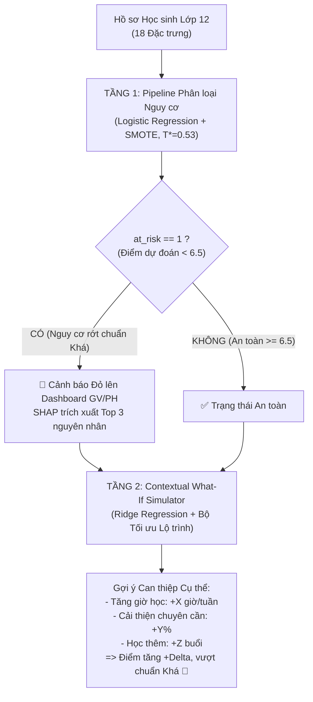

# 🎓 Hệ thống Hỗ trợ Học tập Lớp 12 Việt Nam (What-If Simulator)

> **Dự án:** Machine Learning Capstone / Graduation Project  
> **Phiên bản:** 2.1 — Chuẩn hóa 18 Đặc trưng & Explainable AI (SHAP)  
> **Người thực hiện:** Gia Vỹ (Data & ML Leader)  
> **Đối tượng người dùng mục tiêu:** Giáo viên chủ nhiệm / Giáo viên bộ môn & Phụ huynh học sinh Lớp 12.

---

## 📌 1. Giới thiệu Tổng quan

Hệ thống Hỗ trợ Học tập Lớp 12 là giải pháp Học máy 2 tầng tương hỗ nhằm chuyển hóa các cảnh báo rủi ro học vụ thụ động thành **lộ trình hành động cụ thể, khả thi**:
* **Tầng 1 (Early Warning Classification):** Tự động phát hiện sớm học sinh có nguy cơ không đạt chuẩn loại Khá (điểm thi $< 6.5$) phục vụ xét tuyển Đại học và tốt nghiệp THPT. Tích hợp SHAP giải thích nguyên nhân rủi ro hàng đầu.
* **Tầng 2 (Contextual What-If Simulator):** Dự đoán điểm thi chính xác (thang 0–10) và cung cấp bộ mô phỏng *"Nếu tăng giờ tự học / chuyên cần / học thêm thì điểm thi cải thiện bao nhiêu?"*, đồng thời tự động đề xuất lộ trình can thiệp tối ưu với chi phí nỗ lực thấp nhất.



---

## 🏆 2. Kết quả Thực nghiệm Xuất sắc (Tập Test Độc lập 992 Học sinh)

### 🔵 Tầng 1 — Cảnh báo Nguy cơ (`at_risk < 6.5`, Ngưỡng $T^* = 0.53$)
* **Recall (Bắt trúng nguy cơ):** **97.71%** (Phát hiện 213 / 218 học sinh nguy cơ).
* **Precision (Độ chính xác cảnh báo):** **97.26%** (Hầu như không báo động giả).
* **F1-Score:** **0.9748** | **ROC-AUC:** **0.9974** | **PR-AUC:** **0.9781**
* **MCC (Matthews Correlation):** **0.9677** | **Balanced Accuracy:** **98.47%** | **Specificity:** **99.22%**
* **Brier Score:** **0.0123** (Xác suất dự đoán xuất ra cực kỳ tin cậy).
* **5-Fold Stratified CV trên Train:** $\text{ROC-AUC} = 0.9975 \pm 0.0007$, $\text{Recall} = 0.9859 \pm 0.0076$.

### 🟠 Tầng 2 — Hồi quy Điểm thi & What-If Simulator (Ridge Regression)
* **Test Raw MAE:** **0.0505 / 10** (Vượt xa chỉ tiêu $\le 0.08$, sai số chỉ ~0.5 điểm trên thang 100).
* **Test Raw R²:** **0.6666** (Vượt chuẩn $> 0.60$).
* **Median Absolute Error (MedAE):** **0.0252 / 10** (Trung vị sai số kháng ngoại lai tuyệt đối).
* **Tỷ lệ dự đoán lệch $\le 0.25$ điểm:** **98.99%** | **Lệch $\le 0.50$ điểm:** **98.99%**.
* **Adjusted R² ($R^2_{adj}$):** **0.6604** (Phạt 18 đặc trưng, không bị lạm phát điểm).
* **Độ nhạy (Sensitivity Clean R²):** **0.9909** (Độ chính xác 99.1% khi loại 10 ca nhiễu nhãn Kaggle).
* **Kiểm định tính đơn điệu (Monotonicity Verification):** Đạt 100% (tăng giờ học hoặc chuyên cần thì điểm số cam kết luôn tăng tuyến tính).

---

## 📋 3. Hợp đồng Dữ liệu 18 Đặc trưng Chuẩn hóa

Đã loại bỏ `Gender` và `School_Type` do tầm quan trọng thực nghiệm xấp xỉ 0 (Permutation Importance = 0.0000), đảm bảo tính công bằng và loại trừ thiên vị thuật toán.

1. **Nhóm Hành vi (Actionable Sliders — 5 đặc trưng):**
   * `Hours_Studied`: Giờ tự học/tuần ($1 - 40$).
   * `Attendance`: Tỷ lệ chuyên cần (%) ($60 - 100$).
   * `Sleep_Hours`: Thời lượng ngủ ($4.0 - 10.0$ giờ/đêm).
   * `Tutoring_Sessions`: Số buổi học thêm/phụ đạo ($0 - 8$ buổi/tháng).
   * `effective_study_index`: Chỉ số tích lũy học tập ($\text{Hours} \times \frac{\text{Attendance}}{100.0}$).
2. **Nhóm Hoàn cảnh Cố định (Fixed Context — 13 đặc trưng):**
   * Số (2): `Previous_Scores` (0–10), `Physical_Activity` (0–6h).
   * Thứ bậc (6): `Access_to_Resources`, `Parental_Involvement`, `Teacher_Quality`, `Family_Income`, `Motivation_Level`, `Parental_Education_Level`.
   * Danh định (5): `Internet_Access`, `Learning_Disabilities`, `Extracurricular_Activities`, `Peer_Influence`, `Distance_from_Home`.

---

## 📂 4. Cấu trúc Thư mục Dự án

```
What-If Simulator/
├── data/
│   ├── raw/S2/                       # Dataset gốc: StudentPerformanceFactors.csv
│   ├── processed/                    # Master dataset đã chuẩn hóa 18 features (6,607 HS)
│   └── splits/                       # 5 splits phân tầng chuẩn (Train 70%, Dev BB, Dev Eye, Test 15%)
├── models/
│   ├── pipeline_stage1.pkl           # Pipeline Tầng 1 (18 features -> at_risk)
│   ├── pipeline_stage2_score.pkl     # Pipeline Tầng 2 (18 features -> Exam_Score)
│   └── model_metadata.json           # Siêu dữ liệu cấu hình và toàn bộ metrics kiểm định
├── notebooks/
│   ├── 01_data_prep.ipynb            # Làm sạch, clip biên, scale thang 10, gán nhãn at_risk
│   ├── 02_eda_and_data_splitting.ipynb # 4 biểu đồ EDA và Stratified Splitting 70/15/15
│   ├── 03_stage1_baseline.ipynb      # Logistic Regression Baseline + SMOTE
│   ├── 04_stage1_advanced.ipynb      # So sánh 3 models, threshold tuning, metrics nâng cao & SHAP
│   └── 05_stage2_regression_whatif.ipynb # Ridge Regression, What-If Engine, lọc nhiễu Huber & SHAP
├── reports/
│   ├── figures/                      # 15 biểu đồ chuẩn xuất bản 300 DPI (kèm 4 hình SHAP XAI)
│   └── error_logs/                   # Nhật ký phân tích lỗi định tính trên Dev Eyeball
├── docs/
│   ├── BAO_CAO_DO_AN.md              # Báo cáo học thuật toàn diện phục vụ hội đồng chấm thi
│   └── HANDOFF_APP.md                # Hướng dẫn tích hợp FastAPI, DTO NestJS & Next.js UI
├── Spec.md                           # Bản đặc tả kỹ thuật hệ thống chính thức (v2.1)
├── requirements.txt                  # Danh mục thư viện Python môi trường chuẩn
└── README.md                         # Tài liệu điều hành dự án (file này)
```

---

## 🚀 5. Hướng dẫn Khởi chạy Nhanh

### 5.1 Cài đặt môi trường Python
Yêu cầu Python 3.12:
```bash
git clone https://github.com/Giavy1007/What-If-Simulator.git
cd "What-If Simulator"
pip install -r requirements.txt
```

### 5.2 Kiểm tra Model & Siêu dữ liệu
```bash
python -c "import joblib, json; p1=joblib.load('models/pipeline_stage1.pkl'); p2=joblib.load('models/pipeline_stage2_score.pkl'); print('✅ Nạp thành công cả 2 pipeline!')"
```

### 5.3 Chạy Dịch vụ FastAPI ML Service
Xem hướng dẫn chi tiết và mã nguồn hoàn chỉnh tại [docs/HANDOFF_APP.md](docs/HANDOFF_APP.md):
```bash
uvicorn service.api:app --reload --port 8000
```
Truy cập Swagger UI tại: `http://localhost:8000/docs`.

---

## 📚 6. Hệ thống Tài liệu Tham chiếu Chính thức

1. **[Báo cáo Học thuật Toàn diện (BAO_CAO_DO_AN.md)](docs/BAO_CAO_DO_AN.md):** Luận giải khoa học, kiểm chứng không rò rỉ dữ liệu, giải trình nhiễu nhãn Kaggle và phân tích SHAP Explainable AI.
2. **[Hướng dẫn Tích hợp Kỹ thuật (HANDOFF_APP.md)](docs/HANDOFF_APP.md):** Hợp đồng dữ liệu 18 trường, mã nguồn FastAPI `api.py` có sẵn SHAP, NestJS DTO và React Component What-If Simulator.
3. **[Bản Đặc tả Kỹ thuật (Spec.md)](Spec.md):** Yêu cầu kỹ thuật phiên bản 2.1 và nhật ký hoàn thành các task.
