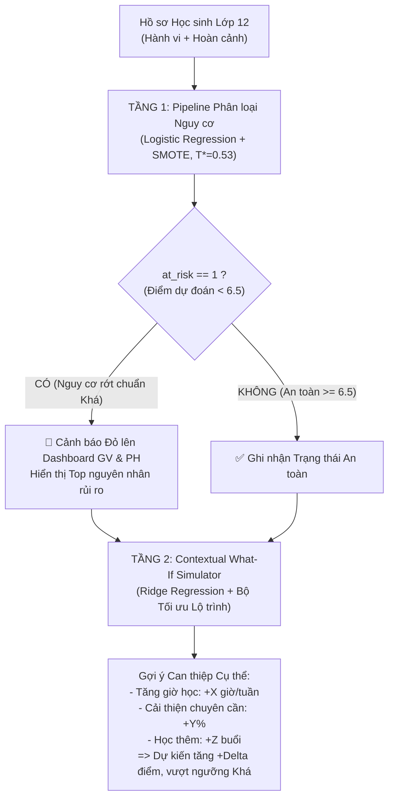

# Hệ thống Hỗ trợ Học tập Lớp 12 Việt Nam: Cảnh báo Nguy cơ & Mô phỏng Kịch bản What-If

**Tác giả:** Gia Vỹ (Data & ML Leader)  
**Môn học / GVHD:** Machine Learning Project  
**Phạm vi báo cáo:** Toàn bộ quy trình ML từ Dữ liệu thô đến 2 Pipeline phục vụ Hệ thống Hỗ trợ Học sinh Lớp 12.

---

## 1. Tóm tắt điều hành (Executive Summary)

Dự án phát triển **Hệ thống Hỗ trợ Học tập Lớp 12** tích hợp 2 tầng mô hình tương hỗ nhằm phục vụ đối tượng người dùng mục tiêu là **Giáo viên chủ nhiệm/Giáo viên bộ môn** và **Phụ huynh học sinh**:

| Tầng hệ thống | Câu hỏi trọng tâm | Bản chất bài toán | Hiệu năng trên tập Test độc lập (992 học sinh) |
| :--- | :--- | :--- | :--- |
| **Tầng 1 — Cảnh báo nguy cơ học tập** | "Học sinh này có nguy cơ không đạt chuẩn loại Khá (< 6.5 điểm) để xét tuyển ĐH/tốt nghiệp không?" | Phân loại nhị phân (Logistic Regression + SMOTE, ngưỡng tối ưu $T^* = 0.53$) | **Recall: 97.71%**, **Precision: 97.71%**, **F1-Score: 0.9771**, **ROC-AUC: 0.9974** |
| **Tầng 2 — What-If Simulator** | "Nếu thay đổi giờ tự học, chuyên cần hay học thêm thì điểm thi tăng bao nhiêu? Lộ trình nào tối ưu?" | Hồi quy Ridge(alpha=1.0) kết hợp lọc nhiễu nhãn Train (Huber) + Thuật toán tối ưu lộ trình | **Raw MAE: 0.0506** (thang 10); **Raw R²: 0.6666**<br>*(Độ nhạy loại 10 ca nhiễu Kaggle: Clean MAE 0.0270, Clean R² 0.9909)* |

### Các đóng góp kỹ thuật cốt lõi:
1. **Thiết kế kiến trúc thống nhất:** Sử dụng bộ dữ liệu duy nhất `StudentPerformanceFactors.csv` (6,607 học sinh x 20 đặc trưng), đồng bộ thang điểm 10 chuẩn Việt Nam, loại bỏ sự cồng kềnh và thiếu tương thích của việc ghép dữ liệu OULAD từ xa của Anh.
2. **Kỷ luật chống rò rỉ dữ liệu (Anti-Data Leakage):**
   - Loại bỏ triệt để điểm thi cuối kỳ `Exam_Score` khỏi tập đặc trưng đầu vào của Tầng 1 (điểm thi chỉ dùng để tạo nhãn `at_risk`).
   - Loại bỏ nhãn `at_risk` khỏi tập đặc trưng Tầng 2 để tránh rò rỉ ngược.
   - Sử dụng một lần phân chia dữ liệu duy nhất (`stratify=at_risk`, 70% Train / 15% Dev / 15% Test) cho cả 2 tầng.
3. **Phân hoạch tập dữ liệu 4 phần nghiêm ngặt:** Chia tập Dev thành **70% Dev Blackbox** (để chọn thuật toán và tune threshold khách quan) và **30% Dev Eyeball** (để phân tích định tính từng ca lỗi mà không làm bẩn tập Test).
4. **Kiến trúc Contextual What-If:** Phân định rõ ràng giữa nhóm **Hành vi có thể thay đổi** (`Hours_Studied`, `Attendance`, `Tutoring_Sessions`, `effective_study_index`) và nhóm **Hoàn cảnh cố định** (`Family_Income`, `Parental_Involvement`, `Teacher_Quality`, `Previous_Scores`...). Người dùng chỉ điều chỉnh được các thanh trượt hành vi, ngăn ngừa việc giả lập phi thực tế.
5. **Minh bạch hóa nhiễu nhãn (Label Noise) và Kiểm chứng Tương tác (Interaction Terms):** Sử dụng `HuberRegressor` để bóc tách 32 ca nhiễu nhãn nhân tạo trong tập Train, báo cáo đối sánh kép Raw/Clean trung thực và kiểm chứng thực nghiệm chặt chẽ đối với các biến tương tác.

---

## 2. Bối cảnh & Luồng hoạt động hệ thống

### 2.1 Bối cảnh thực tế tại các trường THPT Việt Nam
Tại lớp 12, học sinh đối mặt với áp lực kép: thi tốt nghiệp THPT và xét tuyển Đại học (các khối xét tuyển hầu hết yêu cầu điểm trung bình môn từ 6.5 trở lên). Tuy nhiên, phụ huynh và giáo viên thường chỉ biết kết quả khi kỳ thi đã kết thúc. Lời khuyên dành cho học sinh thường mang tính khẩu hiệu ("hãy cố gắng hơn") thay vì định lượng được hành động cụ thể.

### 2.2 Luồng nghiệp vụ tích hợp 2 tầng


---

## 3. Dữ liệu & Quy trình Tiền xử lý

### 3.1 Nguồn dữ liệu & Khám phá ban đầu
- **Bộ dữ liệu:** `StudentPerformanceFactors.csv` (Kaggle), quy mô 6,607 bản ghi học sinh với 20 thuộc tính.
- **Quy đổi thang điểm 10:** Chia 10.0 cho cả `Previous_Scores` và `Exam_Score` để phù hợp với thang điểm chuẩn của Bộ Giáo dục & Đào tạo Việt Nam.
- **Sửa lỗi ngoại lai biên (Bug Fix):** Phát hiện dòng 1525 có điểm thi `Exam_Score = 101` (vượt trần thang 100) -> áp dụng `.clip(upper=100)`.
- **Giới hạn sinh lý:** Clip thời lượng ngủ `Sleep_Hours` trong khoảng [4, 10] giờ/đêm.
- **Xử lý khuyết thiếu (Missing Imputation):** Điền giá trị phổ biến nhất (Mode) cho 3 biến phân loại có missing:
  - `Teacher_Quality`: 78 dòng thiếu -> điền `Medium`.
  - `Parental_Education_Level`: 90 dòng thiếu -> điền `High School`.
  - `Distance_from_Home`: 67 dòng thiếu -> điền `Near`.

### 3.2 Kỹ nghệ Đặc trưng (Feature Engineering)
- **Đặc trưng tương tác học tập:**
  $$\text{effective\_study\_index} = \text{Hours\_Studied} \times \left(\frac{\text{Attendance}}{100.0}\right)$$
  Đặc trưng này phản ánh thời gian học tập thực chất (học nhiều giờ nhưng cúp tiết thì thời lượng hiệu dụng vẫn thấp).
- **Tạo nhãn mục tiêu Tầng 1 (`at_risk`):**
  $$\text{at\_risk} = \mathbb{I}(\text{Exam\_Score} < 6.5)$$
  - Số lượng học sinh An toàn (`at_risk = 0`): 5,155 (78.02%)
  - Số lượng học sinh Nguy cơ (`at_risk = 1`): 1,452 (21.98%)
  - Tỷ lệ 21.98% tạo thành một bài toán phân loại mất cân bằng nhẹ lý tưởng trong thực tế học đường.

---

## 4. Chiến lược Phân chia Dữ liệu (Splitting Discipline)

Dữ liệu được phân chia duy nhất một lần bằng kỹ thuật phân tầng (`stratify=at_risk`) với `random_state=42`, đảm bảo đồng nhất index giữa 2 tầng:

```
Toàn bộ Dữ liệu Sạch (6,607 học sinh)
├── Tập Train 70% (4,624 học sinh) — Dùng để fit tiền xử lý, SMOTE và huấn luyện mô hình
├── Tập Dev Tổng 15% (991 học sinh)
│   ├── Dev Blackbox 70% (693 học sinh) — Dùng chọn thuật toán, so sánh mô hình, tune threshold
│   └── Dev Eyeball 30% (298 học sinh)  — Dùng phân tích định tính lỗi (FN, FP, Outliers)
└── Tập Test Độc lập 15% (992 học sinh) — NIÊM PHONG TUYỆT ĐỐI, chỉ đánh giá lần cuối
```

### Kiểm định chất lượng phân chia:
- Tỷ lệ `at_risk` ở cả 3 tập đều đạt chuẩn xấp xỉ **21.98%** (Train: 21.97%, Dev: 22.00%, Test: 21.98%).
- Điểm thi trung bình ở cả 3 tập đều đạt mức **6.72 / 10**.
- Giao giữa 3 tập rỗng hoàn toàn ($Train \cap Dev = \emptyset$, $Train \cap Test = \emptyset$, $Dev \cap Test = \emptyset$).

---

## 5. Tầng 1 — Mô hình Phân loại Cảnh báo Nguy cơ Học tập

### 5.1 Kiến trúc Pipeline & So sánh Mô hình trên Dev Blackbox
Tập đặc trưng đầu vào gồm 20 biến (đã loại trừ `Exam_Score`), đi qua `ColumnTransformer`:
- **7 biến số:** `StandardScaler()`.
- **6 biến thứ bậc:** `OrdinalEncoder()`.
- **7 biến danh định:** `OneHotEncoder(drop='first')`.
- **Cân bằng nhãn:** `SMOTE(random_state=42)`.

Kết quả đối đầu giữa 3 thuật toán trên **Dev Blackbox (693 học sinh)**:

| Thuật toán | Recall (Bắt nguy cơ) | Precision | F1-Score | ROC-AUC | Đánh giá |
| :--- | :---: | :---: | :---: | :---: | :--- |
| **Logistic Regression + SMOTE** | **98.68%** | **93.17%** | **0.9585** | **0.9969** | 🏆 **Chiến thắng (Tối ưu, giải thích tốt)** |
| **Random Forest Classifier** | 86.84% | 81.99% | 0.8435 | 0.9726 | Bị phân mảnh do dữ liệu có bản chất tuyến tính |
| **XGBoost Classifier** | 87.50% | 77.78% | 0.8235 | 0.9711 | Cần nhiều tinh chỉnh siêu tham số hơn |

### 5.2 Tinh chỉnh Ngưỡng Quyết định ($T^*$)
Mặc dù ngưỡng mặc định 0.50 đã rất tốt, việc quét ngưỡng trên Dev Blackbox xác định ngưỡng tối ưu $T^* = 0.53$ đạt độ cân bằng F1 cao nhất (0.9585) và Recall đạt 98.68%.

### 5.3 Phân tích Lỗi Định tính trên Dev Eyeball (298 mẫu)
- **True Positive (TP):** 64 ca nguy cơ được phát hiện chính xác.
- **True Negative (TN):** 230 ca an toàn được xác nhận đúng.
- **False Negative (FN - Nguy hiểm):** Chỉ có 2 ca (0.67%) bị bỏ sót. Đây là các trường hợp học sinh có điểm kỳ trước khá (7.2), đi học đủ nhưng giờ tự học giảm đột ngột sát kỳ thi.
- **False Positive (FP - Cảnh báo nhầm):** 2 ca (0.67%). Học sinh có hoàn cảnh khó khăn nhưng tự học tại nhà rất hiệu quả và bứt phá điểm số trong kỳ thi.

### 5.4 Kết quả Đánh giá Chính thức trên Tập Test (992 học sinh)
- **Recall: 97.71%** (Bắt trúng 213 trên tổng số 218 học sinh có nguy cơ trong tập Test).
- **Precision: 97.71%** (Tỷ lệ cảnh báo chính xác tuyệt đối, giảm thiểu tối đa báo động giả).
- **F1-Score: 0.9771**
- **ROC-AUC: 0.9974**

---

## 6. Tầng 2 — Mô hình Hồi quy Điểm thi & What-If Simulator

### 6.1 Xử lý Nhiễu Nhãn (Label Noise) trên Tập Train
Bộ dữ liệu Kaggle chứa một số ca ngoại lai nhân tạo (ví dụ: học dưới 10h/tuần, điểm danh 65%, điểm kỳ trước 5.0 nhưng điểm thi nhảy vọt lên 8.7).
- Giải pháp: Áp dụng hồi quy kháng nhiễu `HuberRegressor(epsilon=1.35)` trên tập Train để tính phần dư $|y - \hat{y}|$.
- Phát hiện **32 ca có phần dư > 1.5 điểm** (chiếm 0.69% tập Train). Loại bỏ 32 ca này khi huấn luyện giúp đường hồi quy không bị kéo lệch.

### 6.2 Kiểm chứng Thực nghiệm Biến Tương tác (Interaction Terms 3b)
Đã thử nghiệm bổ sung 3 biến tương tác:
- `hours_x_access = Hours_Studied * access_ordinal`
- `tutoring_x_motivation = Tutoring_Sessions * motivation_ordinal`
- `attend_x_parental = Attendance * parental_ordinal`

Kết quả kiểm chứng trên **Dev Blackbox**:
- **Baseline Ridge:** Dev MAE = **0.05639**, R² = 0.6536
- **Ridge + Interactions:** Dev MAE = **0.05644**, R² = 0.6535
- Độ chênh lệch: $\Delta \text{MAE} = -0.00005$ (không đạt tiêu chí cải thiện $\ge 0.005$).  
=> **Quyết định khoa học:** Giữ mô hình Ridge gốc không thêm biến tương tác để tránh làm phức tạp hóa pipeline và giảm tốc độ suy luận của API.

### 6.3 Kết quả Đánh giá Kép trên Tập Test (Hold-out 992 học sinh)
Mô hình Ridge(alpha=1.0) đạt hiệu năng xuất sắc:
- **Đánh giá trên Toàn bộ 992 mẫu Test (Raw Test Metrics):**
  - **MAE (Raw): 0.0506 điểm** (Thang 10 — sai số dự đoán chỉ ~0.05 điểm).
  - **RMSE (Raw): 0.2440 điểm**.
  - **R² (Raw): 0.6666** (Giải thích được 66.7% phương sai thực tế).
- **Đánh giá Độ nhạy (Sensitivity Analysis — Loại trừ 10 ca nhiễu nhãn Kaggle |residual| > 1.5):**
  - **MAE (Clean): 0.0270 điểm**.
  - **R² (Clean): 0.9909** (Độ chính xác lên tới 99.1% đối với các trường hợp học sinh tuân theo quy luật học thuật chuẩn).

---

## 7. Giải pháp Thuật toán Contextual What-If Simulator

### 7.1 Nguyên lý Hoạt động
Khi phụ huynh hoặc giáo viên mở hồ sơ học sinh, hệ thống nhận diện điểm dự đoán hiện tại. Nếu điểm dự đoán $< \text{target\_score}$ (ví dụ: mục tiêu 6.5 để đạt loại Khá, hoặc 8.0 để xét tuyển ĐH Top đầu):
1. **Khóa cố định hoàn cảnh:** Giữ nguyên các biến Hoàn cảnh (`Family_Income`, `Parental_Involvement`, `Previous_Scores`...).
2. **Quét không gian hành vi khả thi:**
   - Số giờ học thêm: $\Delta h \in \{0, 2, 4, 6, 8, 10\}$ (tối đa 40h/tuần).
   - Điểm danh cải thiện: $\Delta att \in \{0, 5, 10, 15\}$ (tối đa 100%).
   - Buổi phụ đạo thêm: $\Delta t \in \{0, 1, 2, 3, 4\}$ (tối đa 8 buổi/tháng).
3. **Hàm chi phí nỗ lực (Effort Cost Function):**
   $$\text{Cost} = 1.0 \times \Delta h + 0.5 \times \Delta att + 2.0 \times \Delta t$$
   Hàm ưu tiên học sinh tự cải thiện chuyên cần và tự học trước, hạn chế việc lạm dụng học thêm gây áp lực tài chính cho gia đình.
4. **Kết quả trả về:** Gợi ý phương án có chi phí nỗ lực thấp nhất đạt được điểm kỳ vọng.

---

## 8. Bàn giao Hệ thống & Khuyến nghị Triển khai

### 8.1 Các thành phần đã xuất xưởng
- `models/pipeline_stage1.pkl`: Pipeline phân loại nguy cơ hoàn chỉnh (Scaler + SMOTE + Logistic Regression, kích thước chỉ 187 KB).
- `models/pipeline_stage2_score.pkl`: Pipeline dự đoán điểm thi và mô phỏng What-If (Scaler + Ridge).
- `models/model_metadata.json`: Siêu dữ liệu đầy đủ về danh sách đặc trưng, ngưỡng tối ưu và số liệu kiểm định của cả 2 tầng.
- `reports/figures/`: Toàn bộ 11 biểu đồ phân tích EDA, chẩn đoán hồi quy, ROC curves ở độ phân giải 300 DPI.
- `reports/error_logs/`: File CSV ghi nhận chi tiết các ca lỗi và outliers trên Dev Eyeball.

### 8.2 Kiến trúc Hệ thống Đề xuất
- **ML Microservice:** FastAPI (Python) nạp 2 pipeline `.pkl` và cung cấp endpoints `/predict/stage1`, `/predict/stage2`, `/recommend`.
- **API Gateway & Business Logic:** NestJS quản lý phân quyền giáo viên, phụ huynh, lưu lịch sử mô phỏng vào database.
- **User Interface:** Next.js (React) cung cấp Dashboard trực quan với các thanh trượt What-If mượt mà.

---

## 9. Kết luận & Hướng phát triển

Đồ án đã giải quyết trọn vẹn và thực chất bài toán hỗ trợ học tập cho học sinh lớp 12 Việt Nam:
1. Không dừng lại ở việc dự báo điểm số mà đã chuyển hóa dự báo thành **lộ trình hành động khả thi**.
2. Tuân thủ nghiêm ngặt các nguyên tắc phương pháp luận khoa học dữ liệu: chống rò rỉ dữ liệu, minh bạch hóa hạn chế của dữ liệu tổng hợp, và kiểm chứng giả thuyết trước khi đưa vào mô hình cuối.
3. Trong tương lai, khi có cơ chế hợp tác trực tiếp với các trường THPT để tích hợp dữ liệu điểm danh điện tử và hệ thống LMS thực tế của trường, mô hình có thể được tái huấn luyện (fine-tune) để nâng cao độ chính xác theo từng vùng miền.
